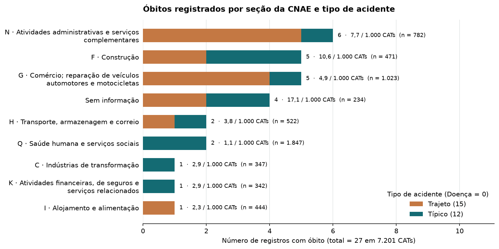

# Relatório de análise exploratória das CATs no Ceará

## 1. Introdução

Os registros de Comunicação de Acidente de Trabalho (CAT) reúnem informações sobre o acidente, o trabalhador e o empregador. Este relatório analisa **7.201 registros distintos pelos campos disponíveis**, com **UF do acidente informada como Ceará** e ocorrência de **1º de janeiro a 30 de junho de 2026**. [Notebook da análise exploratória](01_analise_exploratoria.ipynb)

## 2. Objetivo

O objetivo é descrever os registros de CAT do primeiro semestre de 2026 com UF do acidente informada como Ceará.

### 2.1. Perguntas que queremos responder

1. Qual é o perfil dos trabalhadores acidentados nos registros, por sexo e faixa etária?
2. Quais atividades e setores econômicos dos empregadores concentram mais registros de acidentes?
3. Quais são os principais tipos de acidente registrados na base?
4. Como os acidentes estão distribuídos entre os municípios do Ceará? A base permite comparar os municípios de ocorrência?
5. Existe diferença entre a data do acidente e a emissão da CAT? Quantos dias corridos separam essas datas?
6. Como os registros de acidentes de trabalho variaram ao longo do primeiro semestre de 2026?
7. *(Extra)* Quais setores econômicos e tipos de acidente concentram os registros com óbito — e eles coincidem com os que lideram o volume total de CATs?

## 3. Metodologia

### 3.1. Fonte, recorte e unidade de análise

Foram utilizados os seis CSVs de janeiro a junho em `datasets/CAT_2026/`, lidos com separador ponto e vírgula e codificação Latin-1. Os cabeçalhos repetidos foram identificados por posição, e cada registro preserva o arquivo e a linha de origem. A data de extração dos arquivos locais é desconhecida. [Catálogo de dados abertos do INSS](https://dadosabertos.inss.gov.br/dataset/comunicacoes-de-acidente-de-trabalho-cat-plano-de-dados-abertos-jun-2023-a-dez-2027)

As duas colunas de data do acidente coincidiram nos seis arquivos. O período foi definido pela data registrada na ocorrência. O mês no nome do CSV serviu para auditar a origem das linhas. O recorte inclui CATs emitidas depois de junho quando já constam nos arquivos.

| Etapa do recorte | Registros |
|---|---:|
| Seis CSVs consolidados, com 27 campos de origem | 620.163 |
| UF do acidente registrada como Ceará, em qualquer data | 10.295 |
| UF do acidente registrada como Ceará e data de ocorrência no semestre, antes da deduplicação | 8.849 |
| Cópias adicionais retiradas | 1.648 |
| Base de análise, com uma linha por combinação distinta dos 27 campos originais | **7.201** |

### 3.2. Qualidade dos dados e medidas

A deduplicação preservou a primeira linha de cada combinação idêntica dos 27 campos originais, considerando os arquivos em ordem mensal. O procedimento ocorreu antes da limpeza e da associação com os dicionários. As 7.201 linhas resultantes são a base dos resultados e dos gráficos. As contagens anteriores à deduplicação aparecem na auditoria da base e na avaliação do efeito das repetições sobre a série mensal.

A auditoria separou campos vazios, marcadores como `{ñ class}` e datas zeradas. A data de despacho estava ausente nas 7.201 linhas. A descrição da ocupação estava ausente em 1.118 registros, enquanto o código da CBO faltava em um. Os códigos foram lidos como texto para preservar os zeros à esquerda. Os dicionários locais completaram rótulos quando houve correspondência única. Os casos sem chave, sem correspondência ou ambíguos foram contabilizados separadamente.

A idade foi calculada em anos completos na data da ocorrência. O prazo de emissão foi calculado em dias corridos entre a ocorrência e a emissão.

## 4. Resultados

### 4.1. Perfil por sexo e faixa etária

Dos 7.201 registros distintos, **3.856 (53,55%)** informaram sexo masculino, **3.336 (46,33%)** informaram sexo feminino e **9 (0,12%)** ficaram sem informação. A idade pôde ser calculada em todas as linhas, variou de 15 a 84 anos e teve mediana de **37 anos**.

A faixa de **18 a 29 anos** foi a mais frequente, com **2.092 registros (29,05%)**, dos quais **1.290 (61,66%)** informaram sexo masculino. Entre 40 e 49 anos, o sexo feminino foi o mais frequente, com **1.022 dos 1.919 registros (53,26%)**.

### 4.2. Atividade econômica e ocupação

As duas classes de CNAE mais frequentes foram **atividades de apoio à gestão de saúde (8660)**, com **780 registros (10,83%)**, e **atividades de atendimento hospitalar (8610)**, com **725 (10,07%)**. Juntas, somaram **1.505 de 7.201 registros (20,90%)**.

| Seção da CNAE do empregador | Registros | % das 7.201 linhas |
|---|---:|---:|
| Saúde humana e serviços sociais | 1.847 | 25,65% |
| Comércio e reparação de veículos automotores e motocicletas | 1.023 | 14,21% |
| Atividades administrativas e serviços complementares | 782 | 10,86% |

Havia **234 registros (3,25%)** sem código CNAE informado e três com código sem correspondência no dicionário. Na classificação por ocupação, **técnico de enfermagem** foi a categoria mais frequente, com **890 registros (12,36%)**.

### 4.3. Tipos de acidente e parte do corpo atingida

Todos os registros distintos tinham tipo informado.

| Tipo registrado | Registros | % das 7.201 linhas |
|---|---:|---:|
| Típico | **4.989** | **69,28%** |
| Trajeto | 1.693 | 23,51% |
| Doença | 519 | 7,21% |

O dedo foi a parte do corpo mais citada, em **1.395 de 7.201 registros (19,37%)**. Entre os acidentes típicos, apareceu em **1.331 de 4.989 (26,68%)**. Nos de trajeto, foram **58 de 1.693 (3,43%)**.

### 4.4. Por que a base não permite comparar os municípios de ocorrência

**Os arquivos registram a localização do acidente somente no nível da UF.** O campo `UF  Munic.  Acidente` informa a unidade federativa da ocorrência. Os campos `UF Munic. Empregador` e `Munic Empr` identificam a localização registrada para o empregador. Um acidente pode ocorrer em município diferente daquele em que o empregador está registrado.

A diferença aparece na própria base de análise. Mesmo com Ceará registrado como UF do acidente nas 7.201 linhas, a maioria informa **Brasília** no município do empregador.

| Município registrado para o empregador | Registros | % das 7.201 linhas |
|---|---:|---:|
| Brasília (DF) | 6.668 | 92,60% |
| Fortaleza (CE) | 9 | 0,12% |
| Eusébio (CE) | 1 | 0,01% |
| Demais municípios | 284 | 3,94% |
| Município sem informação | 239 | 3,32% |

Filtrar Fortaleza nesse campo seleciona registros pelo endereço informado para o empregador. Para comparar as ocorrências entre municípios cearenses, seria necessário um campo que identificasse diretamente o município de cada acidente.

### 4.5. Intervalo entre acidente e emissão da CAT

Todos os **7.201 intervalos** puderam ser calculados e foram de zero a **191 dias corridos**. A mediana foi de **4 dias** e o percentil 90 foi de **25 dias**.

| Prazo de emissão | Registros | % dos 7.201 intervalos |
|---|---:|---:|
| No mesmo dia | 388 | 5,39% |
| De 1 a 7 dias | 4.343 | 60,31% |
| De 8 a 30 dias | 1.923 | 26,70% |
| Mais de 30 dias | 547 | 7,60% |

Até o sétimo dia, incluindo as emissões no mesmo dia, foram emitidas **4.731 CATs (65,70%)**. Até o 30º dia, foram **6.654 (92,40%)**. A mediana foi de **20 dias** nos 519 registros de doença, **5 dias** nos 1.693 de trajeto e **4 dias** nos 4.989 de acidentes típicos.

### 4.6. Variação mensal no primeiro semestre

| Mês do acidente | Linhas distintas | Emitidas após junho |
|---|---:|---:|
| Janeiro | 1.115 | 8 |
| Fevereiro | 1.102 | 10 |
| Março | 1.264 | 13 |
| Abril | 1.202 | 17 |
| Maio | **1.305** | 47 |
| Junho | 1.213 | 262 |
| **Total** | **7.201** | **357** |

**Maio** teve a maior contagem de linhas distintas, com **1.305**, e **fevereiro** teve a menor, com **1.102**. Das **7.201 CATs**, **357 (4,96%)** foram emitidas após o semestre, incluindo **262** referentes a acidentes ocorridos em junho.

A auditoria mostra por que usar as linhas distintas muda a leitura da série. A contagem anterior à deduplicação tinha seu pico em junho, com **2.426 linhas**. Das 1.648 cópias adicionais, 1.636 correspondem a linhas do arquivo de junho que também aparecem no arquivo de maio.

### 4.7. Registros com óbito por setor econômico e tipo de acidente

Dos **7.201 registros distintos**, **27 (0,37%)** informaram óbito (`3,7` óbitos a cada 1.000 CATs) e **7.174 (99,63%)** informaram não ter havido óbito, sem valores ausentes nesse campo. Os setores e tipos que concentram os óbitos diferem daqueles que lideram o volume total de CATs.

| Seção da CNAE do empregador | Total de CATs | Óbitos | % dos óbitos | Óbitos / 1.000 CATs | Trajeto | Típico |
|---|---:|---:|---:|---:|---:|---:|
| Atividades administrativas e serviços complementares | 782 | **6** | 22,22% | 7,7 | 5 | 1 |
| Construção | 471 | **5** | 18,52% | **10,6** | 2 | 3 |
| Comércio; reparação de veículos automotores e motocicletas | 1.023 | **5** | 18,52% | 4,9 | 4 | 1 |
| Sem informação | 234 | 4 | 14,81% | 17,1 | 2 | 2 |
| Transporte, armazenagem e correio | 522 | 2 | 7,41% | 3,8 | 1 | 1 |
| Saúde humana e serviços sociais | 1.847 | 2 | 7,41% | 1,1 | 0 | 2 |
| Demais setores com óbito (Indústria, Financeiras, Alojamento) | 1.133 | 3 | 11,11% | 2,6 | 1 | 2 |

Enquanto **Saúde humana e serviços sociais** lidera o volume geral (**1.847 CATs; 25,65%**), registrou apenas **2 óbitos** (`1,1` por 1.000 CATs). Nos óbitos, destacam-se **Atividades administrativas e serviços complementares** (**6**), **Construção** (**5**, com a maior proporção entre setores identificados: `10,6` por 1.000 CATs) e **Comércio e reparação de veículos** (**5**). Além disso, **4 óbitos** ocorreram em registros sem código CNAE informado.

A distribuição por tipo também se inverte em relação ao conjunto geral: os acidentes de **trajeto** concentram **15 dos 27 óbitos (55,56%)**, com **`8,9` óbitos por 1.000 CATs**, frente a **12 óbitos** em acidentes **típicos** (`2,4` por 1.000 CATs) e **zero** em doenças. Coerentemente, **15 dos 27 óbitos** têm como agente causador veículos (`Veículo, NIC`, `Veículo rodoviário motorizado`, `Motocicleta, motoneta`) ou vias públicas (`Rua e estrada`). Quanto ao perfil, **24 dos 27 óbitos (88,89%)** informam sexo masculino (`6,2` por 1.000 CATs, contra `0,9` no feminino) e a idade mediana sobe de **37** para **44 anos**.

## 5. Discussão

A deduplicação reduz a influência da sobreposição entre arquivos. Sem um identificador individual da CAT, a unicidade é definida pelos 27 campos disponíveis. Linhas com os mesmos valores podem corresponder a ocorrências distintas, e uma mesma ocorrência pode aparecer em registros com valores diferentes. A série mensal também depende das emissões já presentes nos arquivos e pode mudar com atualizações da base.

As frequências descrevem a composição das notificações disponíveis. A comparação de risco entre atividades exigiria o número de trabalhadores expostos em cada setor e informações sobre a cobertura e a subnotificação. Nos registros com óbito, o tamanho reduzido do grupo (`n = 27`) torna as proporções por 1.000 CATs sensíveis a variações unitárias, reforçando a leitura estritamente descritiva. Os cruzamentos por sexo, idade e tipo descrevem associações. A divergência entre as UFs registradas merece verificação com a fonte, e a comparação municipal depende da disponibilidade do campo de ocorrência.

## 6. Como reproduzir

Na raiz do projeto, use Python 3.12.14 e instale as dependências com `python -m pip install jupyterlab pandas==3.0.1 matplotlib==3.11.2`. Abra o Jupyter e execute as células em ordem com a raiz do projeto como diretório de trabalho. O notebook inclui as auditorias de esquema e cobertura, as tabelas completas e os gráficos. [Notebook da análise exploratória](01_analise_exploratoria.ipynb)
