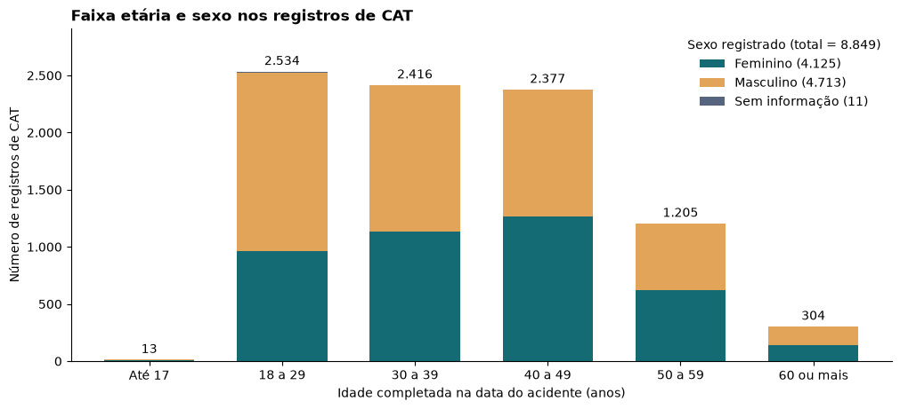
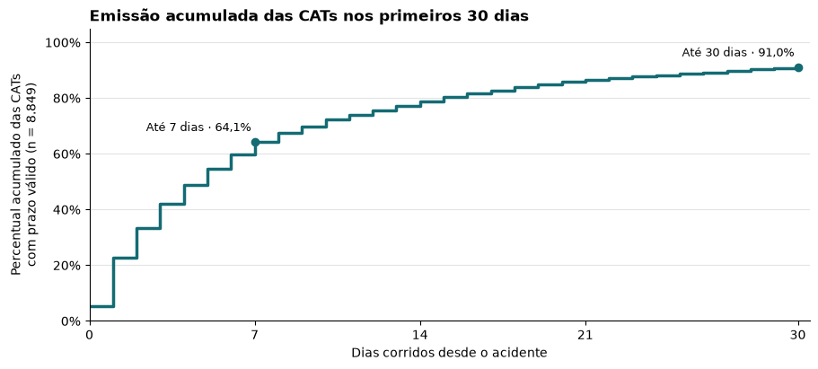

# Comunicações de Acidente de Trabalho no Ceará no primeiro semestre de 2026

## Quais registros entraram na análise?

Dos 620.163 registros nos seis arquivos mensais, 10.295 informam Ceará na **UF do acidente**. Nesse grupo, antes do corte por data, 9.545 (92,71%) indicam Distrito Federal na UF do empregador e apenas 13 indicam Ceará nos dois campos. A localização do empregador, portanto, mudaria a população estudada. O único município disponível é o do empregador.

Entre os registros com UF do acidente Ceará, **8.849 têm data do acidente entre 1º de janeiro e 30 de junho de 2026**. Cada linha representa um registro de Comunicação de Acidente de Trabalho (CAT). Uma mesma ocorrência pode aparecer mais de uma vez.

## O que mostram as comunicações do semestre?

| Aspecto | Resultado entre os registros do semestre |
| --- | --- |
| Idade e sexo | A idade mediana na data do acidente foi de 37 anos. O campo de sexo registra 4.713 casos como masculinos, 4.125 como femininos e 11 sem informação. |
| Tipo de acidente e parte do corpo | A categoria “Típico” foi a mais frequente, com 6.045 registros (68,31%). O dedo foi a parte do corpo mais citada, em 1.687 registros (19,06%). Entre as CATs de acidentes típicos, 26,60% citam o dedo (1.608 de 6.045). Nas de trajeto, essa proporção é de 3,39% (71 de 2.097). |
| Atividade e ocupação | As duas atividades mais frequentes dos empregadores foram apoio à gestão de saúde (CNAE 8660) e atendimento hospitalar (CNAE 8610). Juntas, somaram 1.845 registros (20,85%). Técnico de enfermagem foi a ocupação mais frequente, com 1.102 (12,45%). |
| Prazo de emissão | A mediana entre o acidente e a emissão da CAT foi de cinco dias corridos. Em 714 registros (8,07%), a emissão ocorreu depois de 30 de junho. |

**O perfil por sexo varia com a idade.** Na faixa de 18 a 29 anos, 1.563 dos 2.534 registros (61,68%) informam sexo masculino. Já na faixa de 40 a 49 anos, o sexo feminino é o mais frequente, com 1.262 dos 2.377 registros (53,09%). Os totais dessas faixas incluem, respectivamente, nove e dois registros sem informação de sexo.

**Quase duas em cada três CATs foram emitidas até o sétimo dia após o acidente.** A contagem inclui as 461 emissões no mesmo dia e chega a 5.675 das 8.849 CATs (64,13%). Até o 30º dia, a proporção acumulada atingiu 90,97% (8.050 de 8.849). As 799 restantes (9,03%) levaram mais de 30 dias.

## Por que muda o mês com mais registros?

Das 1.648 cópias adicionais no recorte, 1.636 vêm da sobreposição dos **arquivos de maio e junho**. Todas as linhas selecionadas no arquivo de junho já constam no de maio. Contar esse conteúdo compartilhado uma vez deixa 7.213 linhas. Ao contar uma vez cada combinação dos 27 campos originais, as outras 12 repetições também são descontadas. A tabela mostra o efeito dessa última regra pelo **mês em que ocorreu o acidente**.

| Forma de contagem | Total no semestre | Data do acidente em maio | Data do acidente em junho |
| --- | ---: | ---: | ---: |
| Todas as linhas | 8.849 | 1.608 | **2.426** |
| Linhas distintas nos 27 campos | 7.201 | **1.305** | 1.213 |

Junho concentra mais registros na contagem completa. Quando as linhas idênticas são contadas uma vez, maio passa a liderar. Nessa segunda contagem, o acidente típico continua predominante (4.989 de 7.201, ou 69,28%) e o prazo mediano de emissão passa a quatro dias.

Entre as 7.201 linhas distintas, fevereiro teve a menor contagem, com 1.102 registros. O tipo de acidente estava preenchido em todas elas, e doença foi o tipo menos frequente (519). A faixa de 18 a 29 anos foi a mais frequente (2.092), considerando a idade já completada na data do acidente. Os códigos de apoio à gestão de saúde e de atendimento hospitalar somaram, respectivamente, 780 e 725 registros. Em 4.343 registros, a emissão ocorreu de um a sete dias após o acidente. Em 547, o prazo ultrapassou 30 dias.

Na análise de preenchimento, a data de despacho estava ausente em todas as 7.201 linhas distintas. O código da ocupação estava disponível em mais registros que sua descrição.

## Limitações e próximos passos

Sem um identificador único de CAT, linhas iguais podem corresponder a uma reapresentação ou a ocorrências distintas com os mesmos atributos. Para interpretar a variação mensal e a concentração de empregadores no Distrito Federal, é preciso confirmar com a fonte como os arquivos mensais são compostos e como as UFs são codificadas.

Para as comunicações enviadas pelo eSocial, sistema usado pelas empresas para informar o acidente, o número do recibo identifica a CAT. Ter esse número nos arquivos ajudaria a conferir as repetições diretamente. O CNPJ/CEI disponível identifica o empregador, que pode aparecer em várias comunicações.

A cobertura da base e a subnotificação podem afetar as contagens por atividade e ocupação. Uma comparação de risco entre esses grupos exigiria conhecer o número de trabalhadores expostos em cada um.

## Como reproduzir

Os seis CSVs estão em `datasets/CAT_2026/`. O cabeçalho repete nomes de campos. A posição identifica as duas datas de acidente e os pares de código e descrição. O notebook conserva o arquivo e a linha de origem. A data de download e a versão de extração dos arquivos são desconhecidas. [Catálogo de dados abertos do INSS](https://dadosabertos.inss.gov.br/dataset/comunicacoes-de-acidente-de-trabalho-cat-plano-de-dados-abertos-jun-2023-a-dez-2027)

No diagnóstico dos campos, a contagem de valores distintos ignora espaços externos e diferenças entre maiúsculas e minúsculas. A comparação de linhas repetidas usa os textos originais. No diagnóstico por arquivo, a primeira ocorrência de uma combinação já presente em um CSV anterior entra na coluna de sobreposição. As cópias seguintes no mesmo CSV entram na coluna de repetições internas.

Os dicionários locais permitem recuperar descrições truncadas. Para o agente causador, a chave é o trecho da descrição presente na CAT. Na tabela de cobertura, “Chaves” conta os valores distintos observados, inclusive as grafias dos marcadores no grupo “Sem chave”. Nas distribuições por categoria, o grupo de baixa frequência reúne categorias informadas com até cinco registros cada.

Para reproduzir a análise, use Python 3.12.14 na raiz do projeto, instale as dependências com `python -m pip install jupyterlab pandas==3.0.1 matplotlib==3.11.2` e execute as células em ordem. [Notebook da análise exploratória](01_analise_exploratoria.ipynb)
