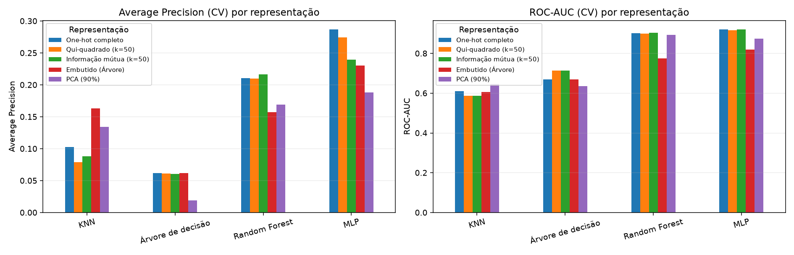
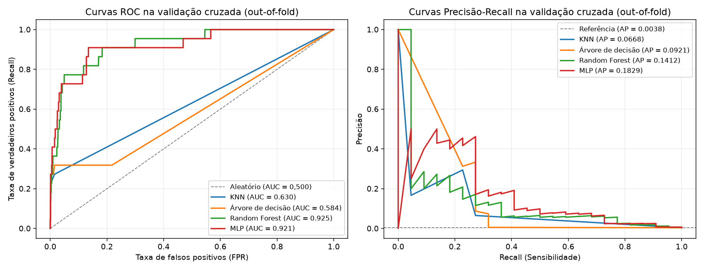
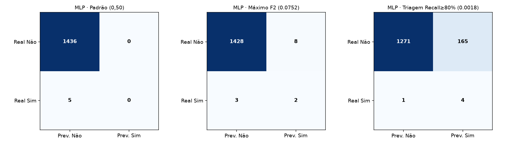
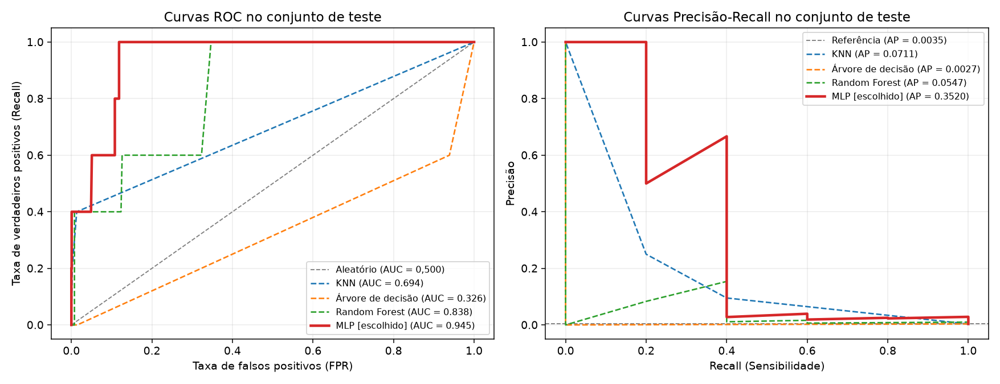

# Atividade 3 — Modelos supervisionados para triagem de óbito nas CATs do Ceará

## Introdução

Uma Comunicação de Acidente de Trabalho (CAT) registra as circunstâncias do acidente, a parte do corpo atingida, a natureza aparente da lesão e a indicação de óbito. Nas CATs do Ceará referentes ao primeiro semestre de 2026 (7.201 registros únicos após remoção de duplicatas exatas), apenas **27 ocorrências indicam óbito (0,37%)**. Apesar de raro, o desfecho fatal concentra-se fortemente em perfis específicos de gravidade — por exemplo, lesões no crânio apresentam taxa de óbito de **16,22%** (6 em 37) e lesões múltiplas atingem **7,14%** (9 em 126), enquanto ocorrências em dedos, mãos e pés têm taxa próxima de zero.

Este estudo conecta diretamente a preparação e a redução de dimensionalidade realizadas em [02_pre_processamento.ipynb](02_pre_processamento.ipynb) ao treinamento e à avaliação de quatro famílias de classificadores em [03_modelos_supervisionados.ipynb](03_modelos_supervisionados.ipynb).

---

## Objetivo e pergunta central

Construir, ajustar e comparar classificadores supervisionados para estimar o risco de **Indica Óbito Acidente** (`Sim = 1`, `Não = 0`) em um cenário de **triagem e avaliação de gravidade no registro do acidente**.

- **Pergunta central:** qual combinação de família de modelos (KNN, Árvore de Decisão, Random Forest e MLP) e representação da etapa de redução de dimensionalidade oferece melhor capacidade de ranqueamento e triagem de óbitos — e como calibrar o ponto de corte priorizando **Recall** para reduzir falsos negativos?

---

## Metodologia

### População e partição treino/teste

Os dados utilizados no treinamento são importados diretamente dos arquivos CSV exportados pelo notebook [02_pre_processamento.ipynb](02_pre_processamento.ipynb):

- [`datasets/processados/treino.csv`](datasets/processados/treino.csv): **5.760 registros** (80%), com **5.738** sem óbito e **22** com óbito (**0,38%**).
- [`datasets/processados/teste.csv`](datasets/processados/teste.csv): **1.441 registros** (20%), com **1.436** sem óbito e **5** com óbito (**0,35%**).

O recorte considera CATs com `UF  Munic.  Acidente == "Ceará"` e `Data Acidente` entre 1º de janeiro e 30 de junho de 2026, após remoção de duplicatas exatas (de 8.849 para 7.201 registros), padronização de `{ñ class}` e ausências como `"Desconhecido"` e associação das descrições truncadas de agente causador ao dicionário oficial (`scripts/agente_causador.py`). A partição utiliza holdout estratificado com `random_state=42`, e o conjunto de teste permanece intocado até a avaliação final.

### Atributos de entrada (cenário de triagem)

Os modelos utilizam **cinco entradas categóricas** disponíveis no registro inicial da gravidade do acidente:

| Atributo | Papel na triagem |
| :--- | :--- |
| `Tipo do Acidente` | Distingue acidente típico, de trajeto e doença (trajeto concentra maior proporção de óbitos). |
| `Agente  Causador  Acidente` | Código oficial do agente causador (veículos, vias, eletricidade, agentes biológicos etc.). |
| `Parte Corpo Atingida` | Região anatômica atingida; lesões em crânio, tórax, abdome e partes múltiplas elevam fortemente o risco. |
| `Natureza da Lesão` | Tipo de lesão registrada (lesões múltiplas, concussão cerebral, asfixia, fratura etc.). |
| `Sexo` | Perfil demográfico do trabalhador (taxa observada de 0,62% no sexo masculino vs. 0,09% no feminino). |

**Exclusões metodológicas relevantes:**
- **`Tipo de Empregador`:** descartado por ser praticamente constante na base (`Cnpj/Cgc` representa **99,90%** das linhas — 7.194 de 7.201 — e todos os 27 óbitos).
- **`CID-10` e `CID-10.1`:** excluídos por representarem diagnóstico médico consolidado posteriormente ao relato inicial (risco de vazamento temporal) e por possuírem **922 códigos distintos** muito pulverizados (8 dos 27 óbitos ocorrem em códigos que aparecem uma única vez na base inteira).

### Validação cruzada, representações da etapa 2 e prevenção de vazamento

Os arquivos CSV são exportados em formato categórico **antes** do *one-hot encoding*. Dentro do conjunto de treino, aplicamos **validação cruzada estratificada em 5 folds (`StratifiedKFold`, `n_splits=5`, `random_state=42`)**, garantindo 4 ou 5 casos de óbito em cada partição de validação.

Em cada fold, o `OneHotEncoder(handle_unknown="ignore")`, o filtro de variância zero e cada redutor investigado em [02_pre_processamento.ipynb](02_pre_processamento.ipynb) são ajustados **exclusivamente no treino do fold** e apenas aplicados à validação:

| Representação (etapa 2) | Descrição | Colunas médias por fold | Mín.–Máx. |
| :--- | :--- | ---: | :---: |
| `One-hot completo` | Indicadores binários após filtro de variância zero | 220,4 | 218–224 |
| `Qui-quadrado (k=50)` | `SelectKBest(chi2, k=50)` | 50,0 | 50–50 |
| `Informação mútua (k=50)` | `SelectKBest(mutual_info_classif, discrete_features=True, k=50)` | 50,0 | 50–50 |
| `Embutido (Árvore)` | Indicadores com importância positiva em `DecisionTreeClassifier(max_depth=5, min_samples_leaf=8, class_weight="balanced")` | 10,8 | 10–12 |
| `PCA (90%)` | `StandardScaler` + `PCA(n_components=0.90)` | 179,4 | 178–182 |

*(A interseção dos filtros produziu 47 de 50 indicadores — quase equivalente aos filtros individuais — e o Wrapper sequencial não entrou na grade por exigir validação cruzada aninhada em cada fold.)*

### Protocolo em duas etapas e modelos comparados

Cada família de classificadores é encapsulada em um módulo próprio na pasta `scripts/`:
- [`scripts/knn.py`](scripts/knn.py) (`KNeighborsClassifier`): `n_neighbors ∈ {3, 5, 11, 21}`, `weights ∈ {"uniform", "distance"}`, distância euclidiana.
- [`scripts/arvore_decisao.py`](scripts/arvore_decisao.py) (`DecisionTreeClassifier`): `max_depth ∈ {4, 8, None}`, `min_samples_leaf ∈ {1, 8}`, `class_weight ∈ {None, "balanced"}`.
- [`scripts/random_forest.py`](scripts/random_forest.py) (`RandomForestClassifier`): 200 árvores, `max_depth ∈ {6, 15, None}`, `min_samples_leaf ∈ {1, 5}`, `class_weight ∈ {None, "balanced"}`.
- [`scripts/mlp.py`](scripts/mlp.py) (`MLPClassifier`): `hidden_layer_sizes ∈ {(32,), (64,), (64, 32)}`, `alpha ∈ {0.0001, 0.01}`, ativação `relu`, otimizador `adam`, `max_iter=300`.
- **Referência majoritária:** `DummyClassifier(strategy="prior")`.

O experimento segue duas etapas na validação cruzada:
1. **Seleção da representação por família:** compara as 5 representações com os parâmetros padrão de cada script e escolhe a melhor por família segundo **Average Precision (PR-AUC)**, com desempate por **ROC-AUC** e **F1-score**.
2. **Ajuste de hiperparâmetros:** executa a grade completa de hiperparâmetros de cada família sobre a sua representação selecionada.

### Critérios de avaliação e calibração de limiar orientada a Recall

Com prevalência de 0,38%, a **acurácia isolada é enganosa** (prever sempre *Não* rende 99,62% de acurácia com 0% de Recall). Por isso, separamos a avaliação em duas decisões:

1. **Escolha do modelo (qualidade do ranqueamento):** prioriza **Average Precision (PR-AUC)** e **ROC-AUC**, que avaliam a capacidade de ordenar os óbitos no topo das probabilidades em todos os limiares possíveis.
2. **Escolha do ponto de corte (triagem operacional):** como **falsos negativos (FN)** são mais graves que **falsos positivos (FP)**, calibramos limiares **exclusivamente nas probabilidades *out-of-fold* da validação cruzada** sob quatro estratégias: padrão (`0,50`), **Máximo `F1`**, **Máximo `F2`** (dá peso 2× maior ao Recall que à Precisão) e **Triagem `Recall ≥ 80%`** (maior limiar que mantém ao menos 80% de sensibilidade na CV).

### Reprodução do ambiente

A partir da raiz do projeto (`CD_CAT_2026`), utilizando o ambiente virtual configurado em `.venv` e as dependências fixadas em [`requirements.txt`](requirements.txt) (Python `3.12.3`, `numpy 2.5.5`, `pandas 3.1.1`, `scikit-learn 1.9.1`, `matplotlib 3.11.2`):

```bash
python3 -m venv .venv
source .venv/bin/activate
pip install -r requirements.txt
jupyter nbconvert --to notebook --execute --inplace 02_pre_processamento.ipynb
jupyter nbconvert --to notebook --execute --inplace 03_modelos_supervisionados.ipynb
```

---

## Resultados

### 1. Impacto das representações da etapa 2 por família (validação cruzada)

Comparando as cinco representações com os parâmetros padrão de cada família na validação cruzada (5 folds):

| Família | One-hot completo (AP / AUC) | Qui-quadrado `k=50` (AP / AUC) | Informação mútua `k=50` (AP / AUC) | Embutido Árvore (AP / AUC) | PCA 90% (AP / AUC) | Representação escolhida |
| :--- | :---: | :---: | :---: | :---: | :---: | :--- |
| **KNN** | 0,1030 / 0,6104 | 0,0793 / 0,5866 | 0,0881 / 0,5862 | **0,1633** / 0,6052 | 0,1345 / 0,6459 | **Embutido (Árvore)** |
| **Árvore de decisão** | **0,0621** / 0,6691 | 0,0610 / 0,7134 | 0,0604 / 0,7130 | 0,0621 / 0,6691 | 0,0192 / 0,6362 | **One-hot completo** |
| **Random Forest** | 0,2106 / 0,9017 | 0,2103 / 0,9007 | **0,2166** / **0,9030** | 0,1572 / 0,7743 | 0,1693 / 0,8936 | **Informação mútua (`k=50`)** |
| **MLP** | **0,2867** / 0,9200 | 0,2743 / 0,9168 | 0,2394 / 0,9202 | 0,2301 / 0,8195 | 0,1885 / 0,8750 | **One-hot completo** |



A redução de dimensionalidade trouxe benefício direto onde faz mais sentido teoricamente:
- No **KNN**, reduzir de ~220 para ~11 colunas via **Embutido (Árvore)** aumentou o Average Precision em **+58,5%** (`0,1030` → `0,1633`), mitigando a diluição das distâncias euclidianas.
- Na **Random Forest**, a **Informação mútua (`k=50`)** superou o one-hot completo reduzindo a dimensão em 77%.
- Na **MLP**, o **One-hot completo** preservou melhor o sinal fino de combinações raras, enquanto o **PCA (90%)** reduziu pouco a dimensão (~179 componentes) e apresentou pior Average Precision em todas as famílias mais fortes.

### 2. Comparação dos finalistas após ajuste de hiperparâmetros (validação cruzada)

| Família | Representação | Melhor configuração | AP (CV) | ROC-AUC (CV) | F1 (limiar 0,50) | Precisão (0,50) | Recall (0,50) | Acurácia (0,50) |
| :--- | :--- | :--- | ---: | ---: | ---: | ---: | ---: | ---: |
| **MLP** | One-hot completo | `hidden_layer_sizes=(32,), alpha=0.0001` | **0,2970** | 0,9212 | 0,0571 | 0,0667 | 0,05 | 0,9960 |
| **Random Forest** | Informação mútua (`k=50`) | `n_estimators=200, max_depth=6, min_samples_leaf=5, class_weight=None` | 0,2417 | **0,9310** | 0,0000 | 0,0000 | 0,00 | 0,9962 |
| **KNN** | Embutido (Árvore) | `n_neighbors=21, weights=uniform` | 0,1786 | 0,6241 | 0,0000 | 0,0000 | 0,00 | 0,9962 |
| **Árvore de decisão** | One-hot completo | `max_depth=8, min_samples_leaf=1, class_weight=None` | 0,1276 | 0,6034 | **0,2887** | **0,3200** | **0,27** | 0,9951 |
| **Referência** | One-hot completo | Majoritário (`strategy="prior"`) | 0,0038 | 0,5000 | 0,0000 | 0,0000 | 0,00 | 0,9962 |

Todas as 6 configurações da **MLP** convergiram sem nenhum aviso (`avisos_convergencia = 0`) dentro do orçamento de 300 épocas.



### 3. Diagnóstico de overfitting (treino vs. validação)

| Família | ROC-AUC (treino) | ROC-AUC (validação) | Gap ROC-AUC | AP (treino) | AP (validação) | Gap AP |
| :--- | ---: | ---: | ---: | ---: | ---: | ---: |
| **MLP** | 0,9924 | 0,9212 | 0,0712 | 0,6824 | **0,2970** | 0,3854 |
| **Random Forest** | 0,9878 | **0,9310** | **0,0568** | 0,3711 | 0,2417 | 0,1294 |
| **KNN** | 0,8523 | 0,6241 | 0,2282 | 0,2143 | 0,1786 | **0,0357** |
| **Árvore de decisão** | 0,9930 | 0,6034 | 0,3896 | 0,8801 | 0,1276 | 0,7525 |

A **Árvore de decisão** individual sofreu forte overfitting (gap de `0,39` em ROC-AUC e `0,75` em AP). Já **MLP** e **Random Forest** mantiveram excelente generalização no ranqueamento (ROC-AUC acima de `0,92` na validação), com a **MLP** liderando em Average Precision (`0,2970` vs. `0,2417`) e sendo escolhida como modelo final antes da inspeção do teste.

### 4. Calibração de limiar orientada a Recall (validação cruzada — MLP)

| Estratégia (calibrada na CV) | Limiar | Recall | Precisão | F2 | F1 | CATs alertadas (%) | VP | FN | FP |
| :--- | ---: | ---: | ---: | ---: | ---: | ---: | ---: | ---: | ---: |
| Padrão (`0,50`) | 0,5000 | 4,55% | 33,33% | 0,0549 | 0,0800 | 0,05% | 1 | 21 | 2 |
| Máximo `F1` (CV) | 0,2228 | 27,27% | 46,15% | 0,2970 | **0,3429** | 0,23% | 6 | 16 | 7 |
| **Máximo `F2` (CV)** | **0,0752** | **40,91%** | 19,15% | **0,3333** | 0,2609 | **0,82%** | **9** | 13 | 38 |
| **Triagem `Recall ≥ 80%` (CV)** | **0,0018** | **81,82%** | 2,40% | 0,1075 | 0,0467 | **13,00%** | **18** | **4** | 731 |

### 5. Avaliação final no conjunto de teste holdout (`1.441` registros, `5` óbitos)

A **MLP** (`hidden_layer_sizes=(32,)`, `alpha=0.0001`, One-hot completo com 228 colunas) foi reajustada nos 5.760 registros de treino e avaliada uma única vez nos 1.441 registros de teste, atingindo **ROC-AUC = `0,9446`** e **Average Precision = `0,3520`** (~100× acima da referência aleatória de `0,0035`):

| Cenário no teste (limiar vindo da CV) | Limiar | Recall | Precisão | F2 | F1 | CATs alertadas (%) | VP | FN | FP | VN |
| :--- | ---: | ---: | ---: | ---: | ---: | ---: | ---: | ---: | ---: | ---: |
| Padrão (`0,50`) | 0,5000 | 0,00% | 0,00% | 0,0000 | 0,0000 | 0,00% | 0 | 5 | 0 | 1.436 |
| Máximo `F1` (CV) | 0,2228 | 20,00% | 100,00% | 0,2381 | **0,3333** | 0,07% | 1 | 4 | 0 | 1.436 |
| **Máximo `F2` (CV)** | **0,0752** | **40,00%** | **20,00%** | **0,3333** | 0,2667 | **0,69%** | **2** | 3 | 8 | 1.428 |
| **Triagem `Recall ≥ 80%` (CV)** | **0,0018** | **80,00%** | 2,37% | 0,1058 | 0,0460 | **11,73%** | **4** | **1** | 165 | 1.271 |





Os resultados do teste confirmaram com notável estabilidade os valores observados na validação cruzada:
- No corte **`F2` (`0,0752`)**, menos de **1% das CATs** (`10` de `1.441`) são sinalizadas, capturando **40% dos óbitos** (`2` de `5`) com 1 acerto a cada 5 alertas (`F2 = 0,3333` tanto na CV quanto no teste).
- No corte de **triagem (`0,0018`)**, encaminhar apenas **11,73% das CATs** (`169` de `1.441`) para revisão prioritária captura **80% dos óbitos** (`4` de `5`), replicando o comportamento da validação cruzada (`81,82%` de recall com `13,00%` de alertas).

---

## Discussões, limitações e próximos passos

- **Valor prático da seleção de atributos de domínio:** a substituição de `Tipo de Empregador` (quase constante) pelos atributos de triagem (`Parte Corpo Atingida`, `Natureza da Lesão` e `Sexo`) elevou o Average Precision na validação cruzada de `0,0130` para **`0,2970`** e o ROC-AUC no teste de `0,6835` para **`0,9446`**.
- **Consistência da redução de dimensionalidade:** aplicar os métodos do [02_pre_processamento.ipynb](02_pre_processamento.ipynb) dentro de cada fold evitou vazamento de dados e permitiu medir o ganho real por família (decisivo para KNN e benéfico para Random Forest, dispensável para MLP com arquitetura enxuta).
- **Limiar padrão vs. custo assimétrico dos erros:** manter o limiar fixo em `0,50` resultaria em `0` alertas no teste apesar de um modelo com `ROC-AUC = 0,9446`. Calibrar o ponto de corte na CV conforme a prioridade de Recall (`F2` ou meta de `80%`) traduz o bom ranqueamento probabilístico em ganho operacional real.
- **Limitações:** a classe positiva possui apenas **27 casos no semestre** (22 no treino e 5 no teste), de modo que cada acerto ou erro no teste altera o recall em 20 pontos percentuais. Além disso, **663 registros** receberam `"Desconhecido"` no agente causador devido a ausências, ambiguidades ou descrições truncadas sem correspondência única, e o uso de holdout aleatório estratificado não testa mudanças temporais ao longo do ano.
- **Próximos passos:** ampliar o recorte temporal (múltiplos anos de CATs) para aumentar o volume de óbitos, avaliar validação temporal (treino em meses anteriores e teste em meses futuros), incorporar atributos complementares como faixa etária e divisão da CNAE e testar técnicas de calibração de probabilidades (Platt scaling / isotônica).
