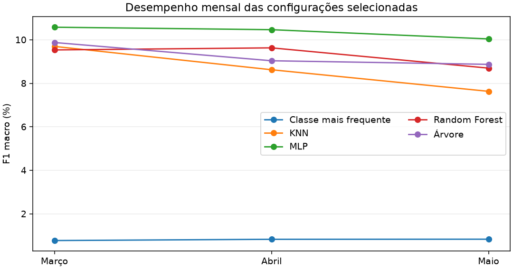
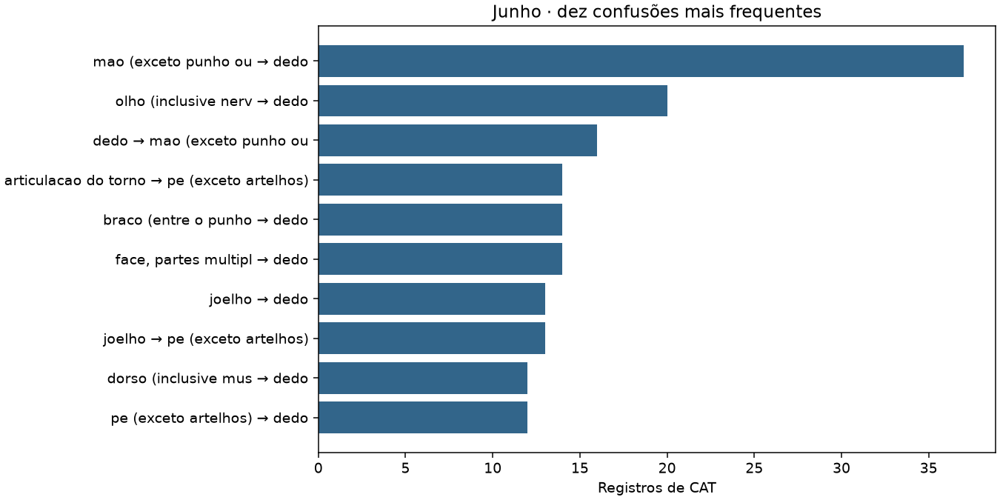

# Atividade 3 — Previsão da parte do corpo atingida nas CATs

## Introdução

Uma Comunicação de Acidente de Trabalho (CAT) registra as circunstâncias da ocorrência e a parte do corpo atingida. Nos registros do Ceará, há uma razão empírica para investigar a relação entre esses campos. Na análise exploratória das 8.849 linhas do semestre, antes da retirada das repetições, o dedo apareceu em 26,60% dos registros de acidentes típicos e em 3,39% dos registros de trajeto. Essa diferença motivou a pergunta do estudo. Quanto o contexto do acidente permite saber sobre a região atingida em um novo registro? [Análise exploratória das CATs](relatorio_analise_exploratoria.md)

## Objetivo

Prever qual categoria será registrada no campo **Parte Corpo Atingida** de uma CAT a partir das informações disponíveis no primeiro relato. Escolhemos esse alvo porque ele registra uma consequência concreta do acidente, tem resposta preenchida para todas as CATs analisadas e permite conferir cada previsão com o registro observado. A questão prática é saber se tipo de acidente, agente e setor econômico sustentariam uma sugestão de preenchimento. Para avaliá-la, comparamos quatro classificadores com a estratégia de sempre sugerir a parte mais frequente e verificamos quais regiões cada modelo consegue distinguir, inclusive as raras.

## Metodologia

### População e validação temporal

Selecionamos as CATs com Ceará informado na UF do acidente e ocorrência entre janeiro e junho de 2026. Como os arquivos não trazem um identificador único da CAT, a unidade de análise é cada combinação distinta dos 27 campos brutos. Das 7.201 combinações, as 5.988 de janeiro a maio formaram o conjunto de desenvolvimento e as 1.213 de junho ficaram reservadas para o teste. No desenvolvimento, havia 42 categorias de parte atingida, seis delas com menos de dez registros. Cada CAT recebeu um único rótulo, inclusive quando o texto indicava partes múltiplas. Preservamos também as descrições truncadas, para avaliar o campo como foi registrado. [Preparação da população](relatorio_pre_processamento_reducao.md)

| Mês do acidente avaliado | CATs no treino | CATs avaliadas | Classes no treino | Classes avaliadas | CATs de classes inéditas no treino |
| ------------------------- | -------------: | -------------: | ----------------: | ----------------: | ----------------------------------: |
| Março                    |          1.816 |          1.264 |                39 |                38 |                                   0 |
| Abril                     |          3.004 |          1.202 |                39 |                41 |                                   3 |
| Maio                      |          4.203 |          1.305 |                41 |                40 |                                   1 |

Cada treino utiliza acidentes anteriores ao mês avaliado, com emissão entre a data do acidente e a véspera do corte. Conferimos a separação pelos identificadores dos registros e pelas datas de ocorrência e emissão. Assim, o treino de cada rodada usa somente informações já registradas antes do mês avaliado.

### Atributos utilizados

| Atributo do modelo escolhido | O que representa | Por que pode ajudar na previsão |
| --- | --- | --- |
| Tipo do acidente (`tipo`) | Classificação da CAT como acidente típico, de trajeto ou doença. | Distingue contextos em que a frequência das partes atingidas varia, como mostra o exemplo do dedo na introdução. |
| Agente causador (`agente`) | Objeto, substância ou outro agente informado na ocorrência, como uma ferramenta manual ou um produto biológico. | Informa com o que ocorreu o contato. Seu uso pressupõe que o agente já seja conhecido no primeiro relato. Nos 119 registros de desenvolvimento sem esse dado, usamos a categoria `[desconhecido]`. |
| Divisão da CNAE (`cnae_divisao`) | Setor do empregador, derivado da Classificação Nacional de Atividades Econômicas (CNAE). | Representa o contexto de trabalho. O agrupamento de 288 códigos informados em 69 divisões no desenvolvimento permite reunir atividades afins, embora a tarefa executada por cada pessoa continue desconhecida. |

As sete representações comparadas também permitiram avaliar os códigos detalhados de atividade e de ocupação (Classificação Brasileira de Ocupações, CBO), a família ocupacional e uma versão sem agente. Convertemos as categorias em indicadores binários (*one-hot encoding*). Nas versões com redução de dimensionalidade, selecionamos indicadores por informação mútua ou aplicamos análise de componentes principais (PCA). Ajustamos cada transformação apenas com os registros de treino da respectiva rodada. Excluímos o próprio alvo, suas derivações, a natureza da lesão e o diagnóstico (CID-10), pois poderiam revelar a região atingida. As datas serviram para separar treino e avaliação. [Preparação e comparação dos atributos](relatorio_pre_processamento_reducao.md)

### Configurações e critério de escolha

| Família            | Parâmetros comparados                                                                                          |
| ------------------- | --------------------------------------------------------------------------------------------------------------- |
| KNN                 | 5 ou 15 vizinhos, com voto uniforme ou ponderado pelo inverso da distância                                     |
| Árvore de decisão | Profundidade máxima 10 ou livre, mínimo de 1 ou 5 registros por folha                                         |
| Random Forest       | 200 árvores, profundidade máxima 15 ou livre, mínimo de 1 ou 5 registros por folha                           |
| MLP                 | 64 unidades ocultas ou duas camadas de 64 e 32, regularização de 0,0001 ou 0,01, Adam e limite de 300 épocas |

Cada família foi combinada com as sete representações do manifesto da etapa 2. São 112 configurações, cada uma avaliada nos mesmos três meses. A referência prevê a classe majoritária de cada treino e atribui probabilidades iguais às proporções das classes nesse treino. A semente das etapas aleatórias é 42. A tabela mensal identifica os parâmetros efetivos, as iterações da MLP e os avisos de convergência. [Resultados mensais](resultados/atividade_03/validacao_mensal.parquet)

A previsão é a classe de maior pontuação. Em cada mês, calculamos precisão, recall e F1 por classe e tiramos a média simples entre as classes presentes. Se uma classe presente nunca é prevista, a precisão é indefinida e entra como zero na média. Seu recall e F1 também são zero. As classes inéditas permanecem nos denominadores. Para ROC-AUC, avaliamos cada classe contra as demais quando há positivos, negativos e uma coluna de probabilidades no classificador. Cada classe avaliável tem peso igual na AUC macro.

Cada mês tem peso igual no F1 de seleção. Entre as configurações até 0,005 abaixo do maior F1 macro médio, preferimos menos campos de entrada, depois o menor desvio-padrão amostral do F1 mensal e, por último, o maior F1 médio. Aplicamos a regra dentro de cada família para apresentar seus resultados e sobre as 112 configurações para escolher o vencedor geral. [Comparação das configurações](resultados/atividade_03/comparacao.parquet)

### Reprodução e uso do modelo

A partir da raiz do projeto e dos Parquets da atividade 2, execute o notebook com Python 3.12. As versões exatas das dependências usadas no treino estão registradas no arquivo da configuração vencedora. [Configuração e ambiente](resultados/atividade_03/escolha.json)

```sh
python -m pip install jupyterlab nbconvert ipykernel numpy==2.3.5 pandas==3.0.1 scipy==1.18.1 scikit-learn==1.9.1 pyarrow==26.0.1 matplotlib==3.11.2 threadpoolctl==3.8.0 joblib==1.6.0
python -m jupyter nbconvert --to notebook --execute --inplace --ExecutePreprocessor.timeout=-1 03_modelos_supervisionados.ipynb
```

Para obter uma previsão, forneça uma linha com os campos categóricos preparados conforme a etapa 2. O pipeline salvo inclui a transformação e o classificador. O exemplo usa um registro de desenvolvimento e associa cada probabilidade ao seu rótulo.

```python
import json
from pathlib import Path

import joblib
import pandas as pd

pasta = Path("resultados/atividade_03")
campos = json.loads((pasta / "escolha.json").read_text(encoding="utf-8"))["entradas"]
modelo = joblib.load(pasta / "vencedor.joblib")
entrada = pd.read_parquet("datasets/preparados_02/desenvolvimento.parquet", columns=campos).head(1)
probabilidades = pd.Series(modelo.predict_proba(entrada)[0], index=modelo.classes_)
print(probabilidades.nlargest(3))
```

## Resultados

### Validação de março a maio

As quatro configurações selecionadas pelas regras da atividade usaram tipo, agente e divisão da CNAE. A MLP liderou nos três meses e apresentou a menor variação mensal de F1 entre os quatro classificadores. Os percentuais abaixo são as médias simples entre meses. A última coluna mostra o desvio-padrão do F1 em pontos percentuais.

| Família              | Configuração selecionada                                          | Acurácia | Precisão macro | Recall macro |         F1 macro | Desvio do F1 (p.p.) |
| --------------------- | ------------------------------------------------------------------- | --------: | --------------: | -----------: | ---------------: | ------------------: |
| MLP                   | 64 unidades, `alpha=0.0001`                                       |    26,16% |          11,01% |       11,11% | **10,36%** |                0,28 |
| Random Forest         | 200 árvores, profundidade livre, 1 registro por folha como mínimo |    25,49% |           9,97% |       10,01% |            9,29% |                0,51 |
| Árvore de decisão   | Profundidade livre, 1 registro por folha como mínimo               |    24,36% |           9,80% |       10,08% |            9,26% |                0,54 |
| KNN                   | 15 vizinhos, voto por distância                                    |    25,03% |           9,89% |        9,59% |            8,65% |                1,03 |
| Classe mais frequente | Proporções do treino                                              |    19,29% |           0,49% |        2,52% |            0,81% |                0,03 |



**Disponibilidade do agente.** Mantendo a configuração da MLP e exatamente as mesmas CATs, a retirada do agente reduziu o F1 macro médio de 10,36% para 5,19%. Em março, abril e maio, o F1 sem agente foi 5,78%, 5,01% e 4,78%, respectivamente. O resultado principal pressupõe que o agente já possa ser informado no primeiro relato. Os 119 registros de desenvolvimento sem esse valor receberam a categoria de ausência da etapa 2. [Comparações pareadas por mês e configuração](resultados/atividade_03/comparacao_agente.parquet)

**Classes raras e convergência.** Nos meses em que apareceram, nenhuma das seis categorias com menos de dez registros no desenvolvimento teve acerto pelos quatro finalistas. A MLP atingiu o limite de 300 épocas em 79 dos 84 ajustes de validação e também no ajuste final. A configuração escolhida atingiu o limite nos três meses. Os resultados descrevem o modelo obtido nesse orçamento de treino. [Métricas mensais por classe](resultados/atividade_03/validacao_por_classe.parquet)

### Teste de junho

Fixamos a MLP antes de avaliar junho e a reajustamos com as 5.565 CATs elegíveis para treino até 31 de maio. Das 1.213 CATs com acidente em junho, todas tinham alvo informado e 262 foram emitidas após 30 de junho. Todas as 38 classes observadas no teste tinham exemplos no treino final. [Contagens por classe e população](resultados/atividade_03/populacao.parquet)

| Métrica da MLP | Média de março a maio |  Junho |
| --------------- | ----------------------: | -----: |
| Acurácia       |                  26,16% | 25,64% |
| Precisão macro |                  11,01% |  8,47% |
| Recall macro    |                  11,11% |  9,67% |
| F1 macro        |                  10,36% |  8,25% |
| ROC-AUC macro   |                   0,649 |  0,655 |

O F1 macro caiu 2,11 pontos percentuais em junho, enquanto a acurácia caiu 0,52 ponto. A classe `dedo` respondeu por 163 dos 311 acertos. Os rótulos truncados `ouvido (externo, med` e `sistema musculo-esqu` tiveram um registro cada e nenhuma previsão. Foram as duas classes presentes com precisão indefinida, contabilizada como zero na média. Outras 19 classes receberam previsões, mas nenhuma correta. [Resultados completos por classe em junho](resultados/atividade_03/junho_por_classe.parquet)

**Dedo contra as demais classes.** Das 229 CATs registradas como dedo, a rede identificou 163 (VP) e atribuiu outra classe a 66 (FN). Entre as 984 CATs das demais categorias, classificou 210 como dedo (FP) e 774 como outra categoria (VN). Assim, recuperou 71,18% dos casos de dedo, mas apenas 43,70% das suas 373 previsões de dedo estavam corretas. A confusão mais frequente foi atribuir dedo a 37 dos 79 registros de mão (46,84%). Também houve 20 registros de olho classificados como dedo, metade dos registros dessa classe.



As matrizes completas trazem as contagens e as proporções por classe registrada em cada mês, para os quatro finalistas e a referência no desenvolvimento e para a MLP em junho. A ROC-AUC de junho usa as 38 classes com positivos, negativos e pontuação disponível. Três classes do treino final tiveram zero positivos no teste e ficaram fora da média. Uma curva baseada em um único positivo é particularmente sensível à posição desse registro na ordenação. [Matrizes de confusão](resultados/atividade_03/matrizes_confusao.parquet) · [Painel de curvas ROC de junho](figuras/atividade_03/roc_junho.png) · [AUC e denominadores por classe](resultados/atividade_03/auc_por_classe.parquet) · [Pontos das curvas por mês](resultados/atividade_03/curvas_roc.parquet)

## Discussões

**O mesmo contexto pode levar a diferentes partes atingidas.** No treino final, 76 CATs de acidentes típicos tinham o mesmo agente registrado (`agente infeccioso ou`, texto truncado) e o mesmo código de atividade econômica (CNAE 8610, atendimento hospitalar). Mesmo nesse grupo específico, apareceram sete categorias de parte atingida, entre elas dedo (51 registros), olho (13) e mão (6). Como as três entradas da rede são idênticas para essas 76 CATs, ela atribui as mesmas pontuações a todas. Mesmo que escolhesse a resposta mais frequente do grupo, erraria 25 desses registros. O agente ajuda a estimar quais regiões são mais prováveis, mas os atributos não descrevem onde ocorreu o contato em cada caso. [Registros de desenvolvimento](datasets/preparados_02/desenvolvimento.parquet)

**A concentração dos acertos explica a distância entre acurácia e F1 macro.** Em junho, a rede sugeriu dedo 373 vezes e acertou 163. Essa única categoria respondeu por mais da metade dos 311 acertos e ajudou a sustentar a acurácia de 25,64%. Já o F1 macro dá o mesmo peso a cada parte do corpo e considera tanto as previsões incorretas quanto os casos perdidos. As 21 categorias sem acerto contribuíram com zero para a média de 38 classes, que ficou em 8,25%. As seis classes raras do desenvolvimento já haviam ficado sem acertos na validação. Todas as classes de junho estavam representadas no treino final. A dificuldade persistiu, portanto, mesmo para rótulos já conhecidos.

**A escolha da MLP se sustenta na comparação entre os modelos.** Com os três atributos, ela teve o maior F1 macro médio na validação (10,36%, ante 0,81% da referência) e o menor desvio mensal entre os quatro classificadores finalistas. Retirar o agente nas mesmas CATs reduziu seu F1 macro para 5,19%, o que mostra quanto a previsão depende dessa informação. A rede atingiu o limite de 300 épocas, mas o experimento não mediu se treinar por mais tempo melhoraria o desempenho em novos registros.

O teste cobre um único mês e depende dos registros disponíveis nos seis arquivos. Atrasos de emissão e divergências entre a UF do acidente e a do empregador limitam a generalização para outros períodos e populações. No recorte estudado, as circunstâncias do acidente ajudam a identificar padrões como a frequência de lesões no dedo. Diante de 902 previsões incorretas em 1.213 CATs de junho, o desempenho é insuficiente para justificar o preenchimento automático da parte atingida em uma CAT individual.
