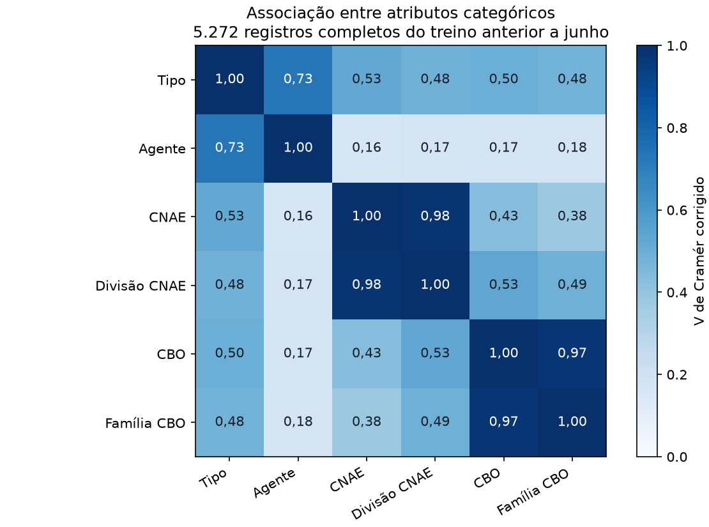
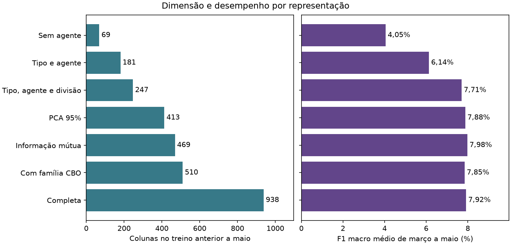

# Relatório da atividade 02 — Pré-processamento e redução da dimensionalidade

## Introdução

Esta atividade prepara os dados para classificar a categoria registrada em **Parte Corpo Atingida**. Cada resposta é uma das categorias observadas, como “Dedo”, “Joelho” ou “Partes múltiplas”. Também investigamos quais informações ajudam a distinguir essas categorias e comparamos maneiras de reduzir as colunas de entrada.

**Sim, houve treinamento nesta etapa.** Ajustamos uma regressão logística multiclasse com parâmetros fixos para medir o efeito do pré-processamento em diferentes representações. Ela é apenas um modelo de referência para esta comparação. Não selecionamos o classificador final. A comparação de KNN, árvores, Random Forest e MLP, seguida pela avaliação final em junho, cabe à atividade 03. Assim, os percentuais deste relatório são resultados preliminares da regressão logística, e não o resultado final do projeto.

## Metodologia

### Preparação dos registros

Lemos os seis CSVs por posição, pois seus cabeçalhos se repetem. Conferimos o esquema, mantivemos os 27 campos como texto e guardamos arquivo e linha de origem. Preservar códigos como texto mantém zeros à esquerda.

Selecionamos registros com Ceará na UF do **acidente** e data do acidente entre janeiro e junho de 2026. Das 8.849 linhas, contamos uma vez cada combinação idêntica dos 27 campos, obtendo 7.201 combinações distintas. Sem identificador da CAT ou do acidente, esse número não representa necessariamente acidentes únicos.

Para classificação, usamos as 5.988 combinações de janeiro a maio, com 42 classes informadas. Seis classes tinham menos de dez registros. Mantivemos classes raras, partes múltiplas e descrições truncadas como registradas. Todas as respostas de parte atingida estavam preenchidas. Uma resposta ausente, se encontrada, seria registrada e excluída da avaliação, sem imputação do alvo.

Padronizamos espaços e caixa para evitar categorias duplicadas por diferenças de escrita e mantivemos o texto original na auditoria. Identificamos valores vazios, `{ñ class}`, códigos de não informado e datas inválidas por campo. Nas entradas categóricas, a falta de informação virou `[desconhecido]`, preservando o registro. Não aplicamos média ou moda a variáveis categóricas.

Conferimos os códigos de CBO, CNAE e CID-10 nos dicionários, registrando associações ausentes ou ambíguas. Usamos os códigos para representar ocupação e atividade econômica. Suas descrições servem à auditoria e interpretação. Quando possível, usamos as hierarquias da CBO e da CNAE para criar família ocupacional e divisão econômica. Para o agente, só recuperamos a descrição completa quando o texto truncado teve uma única correspondência no dicionário.

### Escolha das entradas

O alvo é a categoria de `Parte Corpo Atingida`, portanto esse campo e suas representações equivalentes não entram como preditores. CID-10, descrição do CID e natureza da lesão também ficaram de fora porque podem revelar diretamente a região atingida depois do acidente.

Começamos por **tipo do acidente, agente informado e atividade econômica do empregador**. O tipo tem três categorias e estava preenchido em todos os 5.988 registros do desenvolvimento. O agente tinha 119 ausências e, quando testado sozinho, obteve o maior percentual de acertos entre os atributos individuais avaliados. A CNAE tinha 288 códigos informados. Agrupá-la em divisões reduziu essa variedade a 69 categorias observadas.

Comparamos a ocupação CBO porque ela poderia acrescentar informação ao tipo, agente e setor. O código estava ausente em apenas um registro, mas a descrição faltava em 918. A comparação preliminar não mostrou ganho consistente ao acrescentar a família CBO. Mantivemos essa entrada entre as versões avaliadas, sem assumir que seja necessária.

Sexo, filiação e tipo de empregador ficaram fora da seleção inicial. Usados individualmente, não superaram a referência que sempre escolhe a classe mais frequente. Esse resultado isolado não avalia se esses atributos poderiam ajudar em combinação com outros.

Também deixamos fora da matriz de preditores as datas, a idade e os prazos derivados delas, os campos administrativos e de desfecho, a localização do empregador e o CNPJ/CEI. Datas organizam a separação temporal, mas não são entradas de previsão. A UF do acidente é constante no recorte. Município e UF do empregador descrevem o empregador, não necessariamente o local do acidente. O identificador do empregador poderia permitir memorização de empresas. Essas colunas ainda servem à auditoria e à análise exploratória.

### Como preparamos as colunas e comparamos as versões da base

**1. Verificamos quais campos trazem informações parecidas.**

A CNAE identifica a atividade econômica do empregador. Cada atividade pertence a uma divisão mais ampla. Assim, quando conhecemos o código da atividade, já sabemos sua divisão. Fizemos a mesma pergunta para outros pares de campos: quanto conhecer um deles ajuda a saber o valor do outro?

Para montar o gráfico, contamos quantas CATs apresentavam cada combinação de categorias. Usamos o **V de Cramér com correção de viés** para resumir essas contagens em um número de 0 a 1. Quanto mais perto de 1, mais forte a associação. Esse cálculo faz sentido para códigos como CBO e CNAE porque seus números servem como nomes. A diferença numérica entre dois códigos não mede quanto duas ocupações ou atividades se parecem. Das 5.565 CATs disponíveis antes de junho, 5.272 tinham os seis campos preenchidos e entraram nesse gráfico.

**2. Transformamos as categorias em colunas de sim ou não.**

O campo “tipo do acidente” ajuda a visualizar a transformação. Um único campo com três respostas possíveis virou três colunas. O valor 1 significa “sim” e o valor 0 significa “não”.

| Tipo registrado na CAT | É típico? | É de trajeto? | É doença? |
| --- | ---: | ---: | ---: |
| Típico | 1 | 0 | 0 |
| Trajeto | 0 | 1 | 0 |
| Doença | 0 | 0 | 1 |

Essa técnica se chama **one-hot encoding**. Fizemos o mesmo para agente, ocupação e atividade econômica. Uma entrada sem informação recebeu a categoria `[desconhecido]`. Se uma categoria aparecia pela primeira vez no mês de avaliação, as colunas daquele campo ficavam em zero. Como há centenas de ocupações e atividades, os quatro campos originais passaram a ocupar 938 colunas na comparação de maio.

**3. Comparamos três maneiras de usar menos colunas.**

| Estratégia | O que fizemos com os dados da CAT |
| --- | --- |
| Retirar ou agrupar campos | Em uma das versões, usamos tipo, agente e divisão da CNAE. Cada setor passou a reunir várias atividades econômicas. Essa versão ocupou 247 colunas em maio. |
| Selecionar colunas por **informação mútua** | Para cada coluna de sim ou não, verificamos se a distribuição das partes do corpo atingidas mudava conforme a resposta. A informação mútua pontua quanto essa resposta ajuda a distinguir as partes atingidas. Em maio, guardamos as 469 colunas mais bem pontuadas entre as 938 disponíveis. Cada coluna selecionada conservou seu significado. |
| Combinar colunas com **PCA** | A PCA cria novas colunas calculando somas com pesos diferentes para as colunas originais. Cada nova coluna resume um padrão de variação entre as CATs. Em maio, foram necessárias 413 para representar 95% da variação observada no treino. Esse percentual descreve os dados de entrada. A taxa de acertos foi medida à parte. |

**4. Verificamos se ainda era possível prever a parte do corpo com as colunas reduzidas.**

Por exemplo, para avaliar março, treinamos a regressão logística com acidentes de janeiro e fevereiro cujas CATs já tinham sido emitidas antes de 1º de março. Foi nesse conjunto que definimos as colunas de sim ou não, selecionamos a metade mais bem pontuada e calculamos as combinações da PCA para suas respectivas versões. Depois, aplicamos cada versão às mesmas CATs de março e comparamos as previsões com a parte do corpo registrada.

Repetimos o procedimento em abril e maio, sempre usando os meses anteriores para aprender. Mantivemos o mesmo tipo de classificador e as mesmas configurações em todas as versões para medir o efeito da mudança nas colunas. Junho ficou reservado para a avaliação final da atividade 03.

## Resultados

### Redundância e ausência de informação

- **Datas do acidente.** As duas colunas coincidiram nas 8.849 linhas. Usamos uma para definir os meses e a outra para conferir consistência.
- **CBO.** Nos 5.069 registros do desenvolvimento com código e descrição preenchidos, cada código tinha um único texto. A descrição faltava 918 vezes e o código, uma vez. O código ou a família representa a ocupação na entrada. A descrição fica disponível para auditoria.
- **CNAE.** Nos 5.786 registros com código e descrição, cada código tinha um texto. Porém, 30 descrições truncadas correspondiam a mais de um código. Usamos o código para identificar o setor e também comparamos a divisão CNAE, que reduz a quantidade de categorias informadas de 288 para 69.
- **CID-10.** Nos 5.978 registros com código e descrição, cada um correspondia a um único par. Mantivemos o par para auditoria e excluímos essas informações clínicas dos preditores.
- **Campos quase constantes ou ausentes.** Espécie do benefício apresentou um único valor. Origem do cadastro teve uma única categoria entre os valores informados e faltou em 575 registros. Data de despacho estava ausente em todas as 5.988 combinações.



As associações mais altas ocorreram entre CNAE e sua divisão (V = 0,98) e entre CBO e sua família (V = 0,97). Cada um dos 279 códigos CNAE observados nesse subconjunto pertence a uma única divisão, e cada uma das 531 ocupações pertence a uma única família. O código detalhado permite recuperar o grupo. Usar apenas o grupo reduz a dimensão ao custo de reunir atividades ou ocupações distintas.

Tipo e agente também apresentaram associação (V = 0,73). Nesse caso, a validação ajuda a decidir se vale manter os dois. Usando tipo e divisão CNAE, o F1 macro foi 4,05%. Ao acrescentar o agente às mesmas CATs, subiu para 7,71%. Mesmo associado ao tipo, o agente acrescentou informação para prever a parte do corpo.

### Resultados da regressão logística de referência

A tabela apresenta a média simples das validações de março, abril e maio. Cada mês tem o mesmo peso. **Acertos** é a proporção de registros classificados corretamente. **F1 macro** dá o mesmo peso a cada classe presente no mês. Classes observadas que nunca foram previstas recebem F1 zero. As colunas numéricas são a dimensão da matriz no treino de maio.

| Representação de entrada | Colunas em maio | Acertos médios | F1 macro médio |
| --- | ---: | ---: | ---: |
| Referência: sempre escolher a classe mais frequente | — | 19,29% | 0,81% |
| Agente, tipo, CNAE e CBO detalhados | 938 | 27,92% | 7,92% |
| Tipo e agente | 181 | 28,44% | 6,14% |
| **Tipo, agente e divisão da CNAE** | **247** | **29,25%** | 7,71% |
| Tipo, agente, divisão da CNAE e família CBO | 510 | 28,21% | 7,85% |
| Tipo e divisão da CNAE, sem agente | 69 | 24,99% | 4,05% |
| Seleção por informação mútua na matriz detalhada | 469 | 27,99% | **7,98%** |
| PCA na matriz detalhada | 413 | 27,70% | 7,88% |



Tipo, agente e divisão da CNAE tiveram o maior percentual médio de acertos. A seleção por informação mútua teve o maior F1 macro médio, com uma diferença pequena de 0,06 ponto percentual sobre a matriz detalhada. Acrescentar a família CBO à combinação de tipo, agente e setor aumentou a dimensão de 247 para 510 colunas, sem melhorar o percentual de acertos.

A seleção por informação mútua manteve 323 indicadores nas três rodadas. A sobreposição entre as listas foi de 76,0% entre março e abril e 82,6% entre abril e maio. A PCA preservou 95% da variância com 333, 391 e 413 componentes em março, abril e maio. As duas primeiras componentes somaram 16,64% da variância no treino de maio. O notebook contém os gráficos, os indicadores selecionados e os maiores pesos das componentes.

### Desempenho por classe

A métrica geral esconde diferenças entre classes. Na média das três validações, a versão com tipo, agente e divisão da CNAE teve F1 de 54,4% para “Dedo”, 17,0% para “Joelho” e 6,1% para “Mao (Exceto Punho ou”. Especificamente em maio, 27 das 40 classes presentes ficaram sem acertos. As métricas completas por classe foram salvas para a atividade 03.

## Discussão

Os slides alertam que adicionar atributos não significa necessariamente adicionar informação útil. Nesta comparação, tipo, agente e divisão CNAE tiveram mais acertos que a representação detalhada, usando 247 colunas em vez de 938. Agrupar a atividade econômica manteve uma representação interpretável. A CBO permanece entre as opções de comparação: teve pequena variação no F1 macro, mas aumentou a dimensão da matriz.

A informação mútua é um método filtro. Ela reduziu o número de indicadores, embora as listas tenham variado entre meses. Como pontua colunas individualmente, não garante que o subconjunto seja ótimo em conjunto ou para outro classificador.

A PCA é um método de extração. Seus componentes resumem a variância, mas perdem o significado direto de nomes como “tipo de acidente” ou “setor”. Seu F1 macro médio ficou próximo ao da matriz detalhada. Preservar 95% da variância não garante preservar a separação entre as classes, porque a PCA não considera o alvo na criação dos componentes.

Os resultados descrevem um exercício de preparação com regressão logística de referência. Eles ajudam a comparar as entradas e as reduções, mas ainda não dizem qual classificador será escolhido. A atividade 03 deve comparar os modelos previstos, examinar erros por classe e avaliar uma vez em junho. Junho contém 1.213 registros e não participou da escolha das representações.

A presença do agente e do tipo no primeiro relato é uma hipótese. No desenvolvimento, 4.947 registros tiveram correspondência única do agente ao dicionário, 581 foram ambíguos, 341 não tiveram correspondência e 119 estavam sem informação. A versão sem agente foi comparada nas mesmas observações. Se o agente não estiver disponível no relato inicial real, o resultado com esse campo não representa essa situação.

## Reprodução

A execução usou Python 3.12.14. Na raiz do projeto, instale as dependências e execute o notebook:

```sh
python -m pip install jupyterlab numpy==2.3.5 pandas==3.0.1 scipy==1.18.1 scikit-learn==1.9.1 matplotlib==3.11.2 pyarrow==26.0.1 threadpoolctl==3.8.0
python -m jupyterlab 02_pre_processamento_reducao.ipynb
```

O notebook gera as tabelas, os gráficos, as bases Parquet para a atividade 03 e o manifesto de entradas. As escolhas, interpretações e conclusões estão descritas neste relatório.

## Material da disciplina

- [Pré-processamento de dados](context/Pre-processamentoDeDados.pdf): limpeza, valores ausentes, redundância, codificação categórica e vazamento de informação.
- [Redução de dimensionalidade](context/Reducao_Dimensionalidade.pdf): métodos filtro, seleção de atributos, PCA e extração de atributos.
